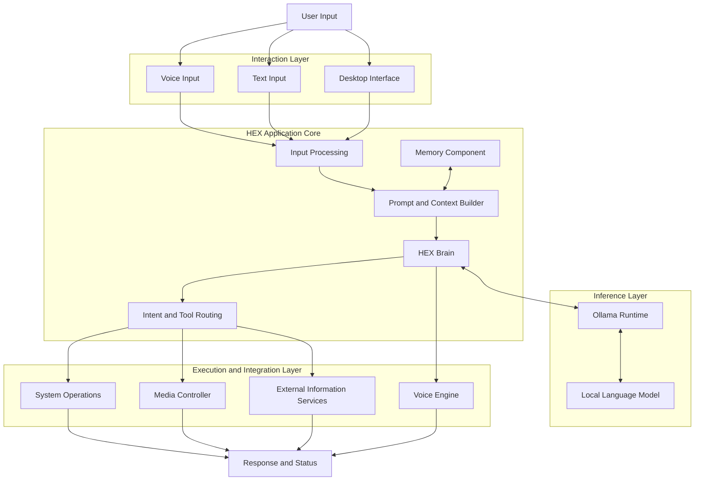
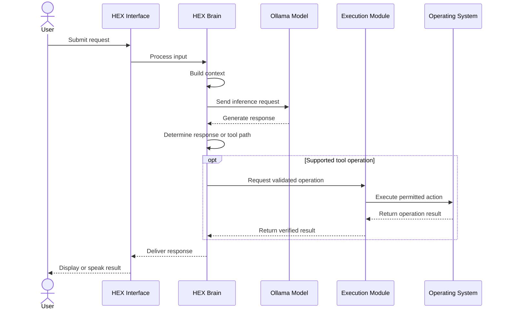

# H.E.X — Cognitive AI & Desktop Automation System

<p align="center">
  <strong>Local Intelligence. Controlled Execution. Private by Design.</strong>
</p>

<p align="center">
  <em>Engineered by DarkDevil</em>
</p>

<p align="center">
  
  
  
  
  
</p>

---

## Overview

**H.E.X (Heuristic Execution Intelligence)** is a locally oriented AI assistant and desktop automation project designed to connect language-model reasoning with practical Windows system interactions.

Built around local language-model inference, voice interaction, desktop automation, and persistent conversational context, HEX aims to provide a unified interface for interacting with a personal computer through natural language.

The project combines AI inference, command interpretation, execution modules, media controls, and optional external intelligence integrations within a modular desktop architecture.

HEX is inspired by the idea of a personal AI system that combines the technical precision of an engineering assistant with the contextual awareness of a conversational companion.

> "I am not here to replace your judgment. I am here to extend your capabilities."

### Project Objectives

* **Local-first intelligence:** Support local language-model inference through Ollama.
* **Natural interaction:** Enable conversational interaction and voice-based commands.
* **Desktop automation:** Connect supported natural-language commands to operating-system actions.
* **Contextual continuity:** Maintain useful conversational context through the project's memory components.
* **Media integration:** Interact with supported Windows media sessions.
* **Extensible intelligence:** Provide integration points for external information and reconnaissance services.
* **Privacy awareness:** Keep core inference local when configured to use a local model without external services.

HEX is an evolving engineering project. Individual capabilities depend on the implemented modules, installed dependencies, model availability, and configuration.

---

## Table of Contents

* [Overview](#overview)
* [Core Capabilities](#core-capabilities)
* [System Architecture](#system-architecture)
* [Model Architecture](#model-architecture)
* [How HEX Works](#how-hex-works)
* [Technology Stack](#technology-stack)
* [Security Architecture](#security-architecture)
* [Privacy and Network Behavior](#privacy-and-network-behavior)
* [Requirements](#requirements)
* [Installation](#installation)
* [Configuration](#configuration)
* [Running HEX](#running-hex)
* [Project Structure](#project-structure)
* [Troubleshooting](#troubleshooting)
* [Testing and Verification](#testing-and-verification)
* [Roadmap](#roadmap)
* [Limitations](#limitations)
* [Licensing](#licensing)
* [Third-Party Attributions](#third-party-attributions)
* [Security Policy](#security-policy)
* [Contributing](#contributing)
* [Acknowledgements](#acknowledgements)

---

## Core Capabilities

### 1. Local Language-Model Inference

HEX integrates with Ollama to communicate with locally hosted language models.

The intended workflow is:

* Accept a user message or recognized voice command.
* Construct an appropriate model prompt.
* Send the prompt to the configured local inference endpoint.
* Receive the generated response.
* Pass the response to the conversational or execution layer.

**Primary integration:** [Ollama](https://ollama.com/)

**Default model example:** Llama 3.2.

The exact model variant must be available in the local Ollama installation.

Local inference can reduce dependence on remote AI services, but it does not automatically make the entire application offline. External search, API integrations, downloads, and optional online services can still require network connectivity.

### 2. Conversational Intelligence

HEX is designed to support a contextual conversational experience through its brain and prompt-management components.

Depending on the current implementation, these components may handle:

* System instructions and persona configuration.
* Message construction and response generation.
* Conversational context.
* Memory retrieval.
* Response cleanup and repetition handling.
* Routing between conversational requests and supported tools.

The language model generates responses; application code determines how those responses are processed and which available actions can be executed.

### 3. Voice Interaction

HEX includes a voice-engine component intended to support speech-based interaction.

The voice pipeline can be organized around:

1. Microphone input.
2. Speech recognition.
3. Command interpretation.
4. Language-model processing.
5. Response generation.
6. Speech synthesis.

The project references Silero and Piper for speech-related functionality.

Actual offline speech recognition and synthesis depend on the selected engines, installed models, language coverage, and configuration.

Natural Hinglish output is a design objective, not a guarantee that every voice model will correctly pronounce every Hindi-English combination.

### 4. Desktop Automation

HEX is designed to provide controlled access to supported Windows operations.

Potential integrations include:

* Application launching and management.
* System-volume control.
* File operations.
* Process inspection and management.
* Browser or application navigation.
* Voice-triggered workflows.

The operations actually available depend on the implemented execution modules.

System-level operations should use explicit permissions, input validation, and confirmation for destructive or security-sensitive actions.

### 5. Media Intelligence

The media-control subsystem is intended to interact with supported Windows media sessions.

Potential functionality includes:

* Detecting active media sessions.
* Reading available playback metadata.
* Extracting track or application information.
* Synchronizing playback progress where supported.
* Controlling media playback and system volume.

Windows System Media Transport Controls (SMTC) can provide media-session information for compatible applications.

Application-specific metadata, album art, and playback controls are not guaranteed to be available for every media player.

### 6. External Intelligence Integrations

HEX includes integration concepts for external information sources and reconnaissance workflows.

Depending on enabled modules, these may include:

* Shodan API integration.
* WHOIS and domain-information lookups.
* Web-based information retrieval.
* Supported social-platform data sources.

External integrations are optional and may require API credentials, internet access, or third-party subscriptions.

Use these integrations only for authorized research and legitimate security purposes. API access does not grant permission to access private accounts, restricted systems, or non-public information.

---

## System Architecture

HEX can be understood as a modular desktop application connecting user interaction, language-model inference, tool routing, and operating-system integrations.

### High-Level Architecture



*Architecture overview: conceptual representation of the intended component relationships. Verify the actual call graph against the current source code before treating every connection as implemented.*

### Architectural Responsibilities

| Component                  | Responsibility                                                  |
| -------------------------- | --------------------------------------------------------------- |
| Interaction layer          | Accept text, voice, and supported UI events                     |
| Input processing           | Normalize and prepare incoming requests                         |
| Prompt and context builder | Construct model input using configured instructions and context |
| HEX Brain                  | Coordinate conversational processing                            |
| Memory component           | Store or retrieve supported conversational information          |
| Ollama runtime             | Provide the local model inference interface                     |
| Language model             | Generate natural-language output                                |
| Tool router                | Select supported operations for execution                       |
| System controller          | Perform authorized operating-system actions                     |
| Media controller           | Handle supported media-session operations                       |
| Voice engine               | Convert speech to text or generated text to speech              |
| External integrations      | Retrieve information from configured third-party services       |

The architecture separates model-generated language from actual system execution. This distinction is important because a language model's output should not automatically be treated as a trusted operating-system command.

---

## Model Architecture

HEX uses a local inference architecture in which an application layer communicates with a model-serving runtime.

### Inference Stack

```text
┌────────────────────────────────────────────┐
│                 HEX Desktop                │
│                                            │
│  User Interface / Voice / Text Input       │
└──────────────────────┬─────────────────────┘
                       │
                       ▼
┌────────────────────────────────────────────┐
│              HEX Brain Layer               │
│                                            │
│  Instructions                              │
│  Context Assembly                          │
│  Memory Integration                        │
│  Response Processing                       │
│  Tool Routing                              │
└──────────────────────┬─────────────────────┘
                       │
                       ▼
┌────────────────────────────────────────────┐
│             Ollama Runtime                 │
│                                            │
│  Model Loading                             │
│  Inference Requests                        │
│  Token Generation                          │
└──────────────────────┬─────────────────────┘
                       │
                       ▼
┌────────────────────────────────────────────┐
│          Configured Language Model         │
│                                            │
│  Example: Llama 3.2                        │
│  Model-specific tokenizer and weights      │
│  Context processing and text generation    │
└────────────────────────────────────────────┘
```

### Model Responsibilities

**HEX application layer**

Responsible for application-specific behavior, prompt construction, memory integration, tool orchestration, and interaction with Windows components.

**Ollama runtime**

Responsible for loading supported models and exposing the inference interface used by the application.

**Language model**

Responsible for generating text based on its learned parameters, input context, and inference settings.

**Execution modules**

Responsible for carrying out supported operations through application code and operating-system APIs.

### Model Configuration

The original project configuration references Llama 3.2.

Example model setup:

```powershell
ollama pull llama3.2
ollama run llama3.2
```

The precise model variant and resource requirements depend on the selected Ollama model tag.

A model's quantization, parameter count, context length, and runtime configuration affect memory consumption, response latency, and output quality.

HEX does not automatically become a newly trained AI model simply by integrating Ollama. Unless separate training code exists, the configured language model remains a pretrained model whose behavior is adapted through prompts, application logic, memory, and tools.

### Model and Application Boundaries

| Layer                | Owns                                              |
| -------------------- | ------------------------------------------------- |
| HEX prompts          | Persona and application instructions              |
| HEX memory           | Application-defined context storage and retrieval |
| Ollama               | Model-serving interface                           |
| Language model       | Text generation                                   |
| Tool implementations | Actual system and external operations             |
| Windows APIs         | Supported operating-system functionality          |

This separation makes it easier to change the model provider or model variant without necessarily redesigning every desktop integration.

---

## How HEX Works

The following describes the intended request lifecycle.

### Stage 1 — Input Capture

The user interacts with HEX through an available input method.

Examples:

* A typed request.
* A recognized voice command.
* An action initiated through the desktop interface.

Voice input requires a working microphone and compatible speech-recognition components.

### Stage 2 — Input Processing

The application prepares the incoming request for further processing.

This stage may include text normalization, input validation, session handling, and determining whether the request needs conversational processing or an available tool.

### Stage 3 — Context Construction

The brain component assembles the information supplied to the language model.

Depending on configuration, this may include:

* System instructions.
* The current request.
* Relevant conversation history.
* Retrieved memory.
* Additional context supplied by application modules.

Only context actually assembled by the application is available to the model. Persistent memory should not be assumed to exist unless its storage and retrieval mechanisms are implemented and enabled.

### Stage 4 — Local Inference

HEX submits the prepared request to the configured Ollama model.

The model generates a response based on the input context and its learned parameters.

In a fully local inference configuration, this stage can operate without sending the prompt to a remote AI provider.

External services used elsewhere in the application may still transmit separate requests.

### Stage 5 — Response Interpretation

The application processes the model output.

For ordinary conversational requests, HEX can return the generated text to the user.

For supported tool requests, the application must identify an available operation and validate the requested parameters.

A model response alone should not be considered proof that an action was successfully performed.

### Stage 6 — Tool Execution

If a request requires a system operation, the corresponding application module performs the operation using its configured permissions.

Examples include adjusting system volume, interacting with a supported media session, or launching an approved application.

A robust implementation should enforce:

* Explicit tool allowlists.
* Argument validation.
* Least-privilege execution.
* User confirmation for high-impact operations.
* Timeouts and error handling.
* Logging that avoids storing unnecessary sensitive data.

### Stage 7 — Result Verification

The application checks the execution result where possible.

For example, a volume-setting operation should verify the resulting volume rather than merely reporting that the volume changed.

Failed operations should return an accurate error message instead of a fabricated success response.

### Stage 8 — Response Delivery

HEX delivers the result through the available interface.

Depending on configuration, the response may be displayed as text or synthesized into speech.

### Request Lifecycle Diagram



*The tool-execution path represents a recommended architecture. Confirm that the current implementation uses equivalent validation and verification steps.*

---

## Technology Stack

The project description references the following technologies.

| Technology                  | Purpose                                      |
| --------------------------- | -------------------------------------------- |
| Python                      | Core application development                 |
| Ollama                      | Local language-model runtime                 |
| Llama 3.2                   | Example language model                       |
| Silero / Piper              | Referenced speech-related components         |
| Pycaw                       | Windows audio-control integration            |
| Windows SMTC                | Supported media-session integration          |
| Shodan API                  | Optional external reconnaissance integration |
| WHOIS services or libraries | Domain-information lookup                    |
| Git                         | Version control                              |

Not every technology is necessarily a mandatory dependency. The actual dependency set should be confirmed using `requirements.txt` and the relevant source files.

Official project resources:

* [Python](https://www.python.org/)
* [Ollama](https://ollama.com/)
* [Llama](https://www.llama.com/)
* [Piper](https://github.com/rhasspy/piper)
* [Silero](https://github.com/snakers4/silero-models)
* [Pycaw](https://github.com/AndreMiras/pycaw)
* [Shodan](https://www.shodan.io/)

---

## Security Architecture

HEX is a desktop automation project, so security must cover more than model behavior.

A local model may generate incorrect, ambiguous, or unsafe instructions. The application should independently validate operations before execution.

### Security Principles

**1. Least privilege**

Run HEX with ordinary user permissions whenever possible. Elevation should be required only for specific operations that genuinely need it.

**2. Explicit tool permissions**

Only expose operations that have been deliberately implemented and approved.

**3. Input validation**

Validate file paths, process identifiers, URLs, command arguments, and other parameters before passing them to operating-system APIs.

**4. Separation of reasoning and execution**

Do not execute arbitrary shell commands simply because they appear in a generated model response.

**5. Confirmation for high-impact actions**

Require explicit authorization for destructive file operations, software installation, privilege changes, and other sensitive actions.

**6. Credential protection**

Store API credentials outside source code and exclude them from version control.

**7. Safe error handling**

Avoid exposing API tokens, private file contents, or sensitive system information in error messages and logs.

**8. Auditable execution**

Record security-relevant actions when appropriate, while minimizing the collection of sensitive information.

### Recommended Trust Boundary

```text
Untrusted Input
      |
      v
Language Model
      |
      v
Candidate Action
      |
      v
Policy and Validation Layer
      |
      v
Permission / Confirmation Check
      |
      v
Approved Tool
      |
      v
Operating-System API
      |
      v
Execution Result
      |
      v
Verification and Response
```

The policy and validation layer should be enforced by application code rather than relying solely on the model's system prompt.

### Devil Mode

Devil Mode is a project-specific interaction mode intended to provide a distinctive interface and response style.

A visual mode change, red interface, or modified persona does not need to disable security controls.

Recommended behavior:

* Permit cosmetic and conversational changes.
* Keep authorization checks active.
* Preserve tool restrictions.
* Require confirmation for high-impact operations.
* Prevent the mode from silently elevating privileges.

**A different persona should not mean unrestricted operating-system access.**

---

## Privacy and Network Behavior

HEX is designed around local inference, but local inference and complete network isolation are different properties.

### Local Processing

When configured with a local Ollama model, inference can run on the user's machine.

This can reduce exposure to remote AI services and keep model prompts local to the inference process.

### Optional Network Access

The following activities may still require network connectivity:

* Downloading models and Python packages.
* Querying Shodan or other external information providers.
* Performing web searches.
* Accessing third-party APIs.
* Retrieving external updates.

### Privacy Recommendations

* Review the code paths responsible for network requests.
* Keep API credentials out of the repository.
* Avoid storing unnecessary conversation history.
* Exclude private logs and local configuration files from Git.
* Use local speech-recognition and synthesis models if offline voice processing is required.
* Test network behavior before describing the application as air-gapped.

HEX should only be described as fully offline or air-gapped after its actual dependencies and network behavior have been verified.

---

## Requirements

### Minimum Software Requirements

* Windows environment compatible with the implemented integrations.
* Python 3.11 recommended by the original project documentation.
* Git.
* Ollama installed and operational.
* A compatible language model pulled into Ollama.
* Python dependencies specified by the repository.

### Hardware Considerations

Hardware requirements depend on the selected language model, quantization, context length, and speech components.

Available RAM and GPU memory can affect inference speed and whether a model runs entirely on the GPU.

No single hardware configuration guarantees a particular response latency.

---

## Installation

### 1. Install Python

Install a compatible Python version from the official website:

https://www.python.org/downloads/

Verify the installation:

```powershell
python --version
```

### 2. Install Ollama

Install Ollama from:

https://ollama.com/

Verify that it is available:

```powershell
ollama --version
```

### 3. Download the Language Model

For the default model referenced in this README:

```powershell
ollama pull llama3.2
```

Verify that the model is available:

```powershell
ollama list
```

Test the model independently:

```powershell
ollama run llama3.2
```

### 4. Clone the Repository

```powershell
git clone https://github.com/D3V1L96/HEX-Cognitive-Weapon.git
```

Enter the project directory:

```powershell
cd HEX-Cognitive-Weapon
```

### 5. Create a Virtual Environment

```powershell
python -m venv .venv
```

Activate it in PowerShell:

```powershell
.\.venv\Scripts\Activate.ps1
```

If PowerShell blocks activation, use an approved environment-specific workaround rather than changing system-wide execution policy unnecessarily.

### 6. Install Dependencies

Upgrade pip:

```powershell
python -m pip install --upgrade pip
```

Install repository dependencies:

```powershell
pip install -r requirements.txt
```

Some optional speech or Windows integrations may require additional platform-specific installation steps.

### 7. Launch HEX

Use the entry point documented by the project:

```powershell
python hex_main.py
```

If the application fails to start, review the error message, installed dependencies, Ollama availability, and the actual entry-point configuration.

---

## Configuration

Configuration should be kept separate from source code wherever practical.

Typical settings may include:

| Setting                  | Purpose                                     |
| ------------------------ | ------------------------------------------- |
| Model identifier         | Selects the Ollama model                    |
| Ollama endpoint          | Specifies the local inference service       |
| Voice engine             | Selects supported speech components         |
| Memory configuration     | Controls available context-storage behavior |
| External API credentials | Enables optional third-party integrations   |
| Logging level            | Controls diagnostic output                  |

The exact environment-variable names and configuration files depend on the current implementation.

Do not add fictional configuration variables to production documentation. Document each setting only after confirming how the application reads it.

### Credential Management

Never commit real API keys, access tokens, passwords, or private configuration files.

Use environment variables or an appropriate local secrets mechanism for sensitive values.

If a credential has already been committed, revoke or rotate it. Removing it from the latest commit alone does not remove it from Git history.

---

## Project Structure

The following is the structure described in the original project documentation. Confirm each path against the actual repository before relying on it.

```text
HEX-Cognitive-Weapon/
│
├── hex_main.py
│   └── Main application entry point and UI coordination
│
├── hex_brain.py
│   └── Prompt processing, conversational logic, and memory integration
│
├── hex_voice_engine.py
│   └── Voice-related processing and speech output
│
├── media_controller.py
│   └── Media-session and audio-control integrations
│
├── requirements.txt
│   └── Python dependency declarations
│
├── index.html
│   └── Project website or portfolio interface
│
├── README.md
│   └── Project documentation
│
└── LICENSE
    └── Repository license, if present
```

Optional modules, tests, configuration files, and local data directories should be documented as they are added.

---

## Troubleshooting

### Ollama Is Not Available

Check the installation:

```powershell
ollama --version
```

Check installed models:

```powershell
ollama list
```

Test the model directly:

```powershell
ollama run llama3.2
```

If the model works independently but HEX cannot connect, inspect the endpoint and error handling in the application's inference client.

### Model Not Found

Pull the exact model identifier configured in HEX:

```powershell
ollama pull llama3.2
```

Check the model's identifier against the application's configuration.

### Python Dependency Errors

Activate the project's virtual environment and reinstall the declared dependencies:

```powershell
.\.venv\Scripts\Activate.ps1
python -m pip install -r requirements.txt
```

If a dependency fails to install, investigate its supported Python versions and operating-system requirements before changing package versions.

### Voice Input or Output Does Not Work

Check:

* Microphone permissions.
* The selected input and output devices.
* Speech-engine dependencies.
* Required model files.
* Language and voice-model compatibility.
* Audio-library compatibility with the installed Python version.

### Media Metadata Is Missing

Some applications expose incomplete media-session information. Verify the behavior using a supported Windows media application before diagnosing it as a HEX defect.

---

## Testing and Verification

Testing should cover both ordinary conversational behavior and actual operating-system interactions.

### Recommended Test Categories

| Test Category   | What to Verify                                                   |
| --------------- | ---------------------------------------------------------------- |
| Startup         | Application initializes without unexpected exceptions            |
| Inference       | Configured local model responds successfully                     |
| Context         | Requests receive the intended context                            |
| Memory          | Storage and retrieval follow the implemented design              |
| Voice           | Supported speech input and output work                           |
| Media           | Compatible sessions return expected information                  |
| Volume          | Requested settings match verified system state                   |
| File operations | Path validation and permission checks work                       |
| Tool routing    | Unsupported actions are rejected                                 |
| Security        | Untrusted model output cannot bypass tool authorization          |
| Network         | Local inference and optional external calls behave as documented |
| Error handling  | Failures do not produce fabricated success messages              |

### Manual Verification

Before describing a capability as production-ready, verify it independently.

For example:

1. Confirm Ollama can run the configured model.
2. Launch HEX.
3. Submit a conversational request.
4. Confirm the response comes from the intended model.
5. Test one supported desktop operation.
6. Confirm the operating system actually reflects the requested change.
7. Test invalid input and unavailable dependencies.
8. Inspect logs for accidental exposure of sensitive information.

Automated tests should be added alongside the implementation as the project grows.

---

## Roadmap

The following items are proposed development goals, not claims that every feature is already implemented.

* [ ] Document the complete application call graph.
* [ ] Add automated tests for core brain functionality.
* [ ] Introduce a formally defined tool-permission registry.
* [ ] Add validation and confirmation for high-impact actions.
* [ ] Improve offline speech-processing support.
* [ ] Add reliable media-session error handling.
* [ ] Document memory storage and retention behavior.
* [ ] Add configurable network-access controls.
* [ ] Create reproducible installation and environment checks.
* [ ] Add structured diagnostic logging.
* [ ] Document third-party model and dependency licenses.
* [ ] Add a security disclosure process.
* [ ] Publish benchmark results for supported hardware.
* [ ] Add release notes and versioned configuration documentation.

---

## Limitations

HEX is an actively evolving desktop AI project.

Its behavior is constrained by the configured model, the quality of the input context, available system resources, dependency compatibility, and the implemented tool integrations.

Important limitations include:

* Language models can produce incorrect or misleading responses.
* Local inference does not guarantee factual accuracy.
* Offline operation depends on the enabled dependencies and services.
* Hinglish speech quality depends on the selected speech engine and voice model.
* Media metadata availability varies by application.
* External integrations may require credentials, subscriptions, or internet access.
* Desktop automation can fail when permissions, application state, or operating-system behavior changes.
* Full-machine access should not be assumed merely because some system-control modules exist.

HEX should be evaluated through reproducible tests rather than branding claims or unverified performance estimates.

---

## Licensing

HEX requires a clearly defined licensing strategy covering its original source code and all third-party components.

### 1. Main Project License

If the repository's root `LICENSE` file contains the MIT License and you have the rights to license the relevant code, the project can use the MIT License for that code.

The MIT License permits use, modification, distribution, sublicensing, and commercial use, subject to its terms, including preservation of the required copyright and license notices.

It also includes a warranty disclaimer and limitation of liability.

The license should be included in the repository as a complete, unmodified license text with the appropriate copyright holder and year.

Reference: https://opensource.org/license/mit/

### 2. International Copyright

Copyright protection and licensing are separate concepts.

Copyright may arise automatically under the laws of applicable jurisdictions. An open-source license grants specified permissions to recipients; it does not eliminate copyright protection.

The MIT License can be used internationally. There is no requirement to attach a separate national copyright license for every country in which a project might be used.

### 3. Third-Party Components

HEX may depend on libraries, model weights, voice models, and external services governed by separate terms.

Before distribution, review the actual licenses and notices for every component included or redistributed with HEX.

In particular, distinguish between:

* Python packages installed from package repositories.
* Model weights downloaded from a model provider.
* Speech models and voice assets.
* External APIs and hosted services.
* Assets included in the desktop application or website.

A package's license does not automatically determine the license of its associated model weights or external service.

### 4. License Compatibility

Do not automatically replace every third-party license with MIT.

Depending on the component, redistribution may require preserving notices, providing source code, satisfying attribution requirements, or following separate model and service terms.

A dependency inventory should be completed before publishing a bundled release.

### 5. Trademark and Branding

The MIT License does not automatically grant trademark rights over names, logos, or branding.

The HEX project name, artwork, and other brand assets may need separate documentation if trademark protection or explicit reuse restrictions are desired.

### License Summary

| Component                      | Licensing approach                         |
| ------------------------------ | ------------------------------------------ |
| Original HEX source code       | Repository's declared project license      |
| Third-party Python libraries   | Their respective licenses                  |
| Language-model weights         | The exact model license and terms          |
| Speech models and voice assets | Their respective licenses                  |
| External APIs                  | Provider terms and acceptable-use policies |
| Branding and artwork           | Applicable ownership and reuse terms       |

**Important:** This README is documentation, not a legal opinion. Confirm ownership, component licenses, redistribution rights, and applicable obligations before publishing a release.

---

## Third-Party Attributions

HEX relies on external projects and may integrate additional components as development progresses.

Relevant upstream resources include:

| Project       | Resource                                  |
| ------------- | ----------------------------------------- |
| Python        | https://www.python.org/                   |
| Ollama        | https://ollama.com/                       |
| Llama         | https://www.llama.com/                    |
| Piper         | https://github.com/rhasspy/piper          |
| Silero Models | https://github.com/snakers4/silero-models |
| Pycaw         | https://github.com/AndreMiras/pycaw       |
| Shodan        | https://www.shodan.io/                    |

This list identifies referenced technologies, not a complete dependency or license audit.

Before distributing HEX, generate an inventory from the actual dependency files and inspect the license terms of the exact versions and assets being used.

Preserve required copyright notices and attribution files.

---

## Security Policy

Security issues affecting desktop automation, credential handling, local services, or system-command execution should be handled responsibly.

When reporting a vulnerability, include:

* Affected component and version.
* Operating system and relevant environment details.
* Reproduction steps.
* Expected and actual behavior.
* Potential impact.
* A proposed mitigation, if available.

Do not publish real credentials, private user data, or exploit details that could unnecessarily expose other users while a vulnerability is being investigated.

A private reporting channel should be configured in the repository's GitHub security settings before claiming that a dedicated disclosure process is operational.

---

## Contributing

Contributions are welcome.

Potential areas include:

* Bug fixes.
* Architecture documentation.
* Automated testing.
* Voice-engine compatibility.
* Desktop automation reliability.
* Privacy improvements.
* Security validation.
* Dependency and license documentation.

### Contribution Guidelines

1. Open an issue describing the problem or proposed improvement.
2. Keep changes focused and avoid unrelated modifications.
3. Include reproduction steps for bug fixes.
4. Add tests where practical.
5. Document configuration changes.
6. Check dependency and licensing implications.
7. Avoid committing credentials, personal data, or machine-specific configuration.
8. Describe any security-sensitive behavior clearly.

For substantial changes, discuss the proposed design before submitting a large implementation.

---

## Acknowledgements

HEX builds on the broader open-source AI, Python, speech-processing, and Windows automation ecosystems.

Credit belongs to the maintainers of the libraries, model providers, and tools that make this work possible.

The purpose of HEX is to bring these technologies together into a cohesive, locally oriented desktop assistant.

---

## Author

**DarkDevil**

GitHub: https://github.com/D3V1L96

Repository: https://github.com/D3V1L96/HEX-Cognitive-Weapon

**Project:** H.E.X — Cognitive AI & Desktop Automation System
**Version:** 2.0
**License:** MIT, subject to verification of the repository's actual license and third-party components.

---


<p align="center">
  <strong>H.E.X</strong><br>
  Local Intelligence. Controlled Execution. Private by Design.
</p>
